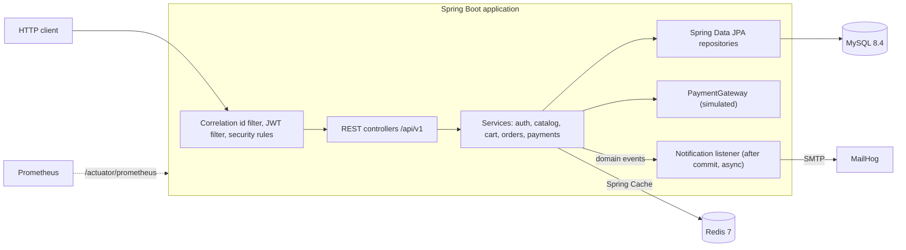
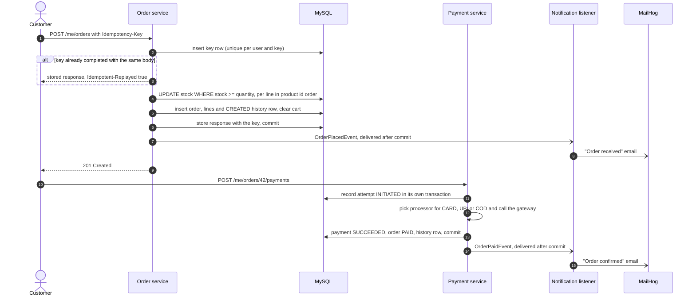

# E-commerce Backend

[](https://github.com/Darshan-05032003/ecommerce-backend/actions/workflows/ci.yml)

A REST API for a small online shop, built with Java 21, Spring Boot 4.1 and MySQL. Customers browse a cached catalogue, fill a cart, place orders with an idempotency key and pay by card, UPI or cash on delivery; admins manage the catalogue and move orders through a state machine with a full audit history. The project focuses on the parts that make a backend correct under real traffic: money arithmetic, stock that cannot be oversold by concurrent buyers, safe retries, rotating refresh tokens, emails sent only after a commit, and tests that run against real MySQL and Redis containers.

## Tech Stack

| Area | Technology |
|------|------------|
| Language and framework | Java 21, Spring Boot 4.1 (Web MVC, Security, Data JPA, Cache, Mail, Actuator) |
| Persistence | MySQL 8.4, Hibernate, Flyway migrations |
| Caching | Redis 7 through Spring Cache |
| Security | JWT access tokens (jjwt), opaque rotating refresh tokens, BCrypt, Bucket4j rate limiting |
| API | Bean Validation, MapStruct, RFC 9457 problem details, springdoc-openapi (Swagger UI) |
| Observability | Actuator health probes, Micrometer with Prometheus format, ECS JSON logs in `prod` |
| Testing | JUnit, Mockito, AssertJ, Awaitility, Testcontainers, JaCoCo |
| Delivery | Maven wrapper, multi-stage Dockerfile, Docker Compose, GitHub Actions |

## Architecture



The code is organised by feature (`auth`, `user`, `category`, `product`, `cart`, `order`, `payment`, `notification`), with shared infrastructure under `common` (security, error handling, configuration, async executor, observability, OpenAPI).

## Order Flow



An admin then moves the order to `SHIPPED` and `DELIVERED` with `PATCH /api/v1/admin/orders/{id}/status`; every step adds a history row with who made the change and when.

## Key Design Decisions

- **Money** is `BigDecimal` with scale 2 and `HALF_EVEN` rounding, stored as `DECIMAL`, compared with `compareTo`. Each order line stores its unit price and rounded line total at the time of ordering; the order total is the sum of the stored lines.
- **Stock concurrency**: each line is reserved with one conditional `UPDATE ... SET stock = stock - ? WHERE id = ? AND stock >= ?`; zero affected rows rolls the whole order back. Lines are reserved in product id order so two orders cannot deadlock. A test sends 20 concurrent buyers at the last 5 units and expects exactly 5 orders and a stock of 0. Admin product edits use optimistic locking (`@Version`), so a stale edit gets `409`.
- **Idempotency**: `POST /api/v1/me/orders` requires an `Idempotency-Key`. The key, the user, a SHA-256 hash of the body and the response are stored in the order transaction. A retry with the same key replays the stored response; the same key with a different body is `422`; concurrent requests with one key create one order. A scheduled job deletes keys older than 24 hours.
- **Order state machine and audit**: `OrderStatus` defines the allowed moves (`CREATED -> PAID -> SHIPPED -> DELIVERED`, `CANCELLED` from `CREATED` or `PAID`). Anything else is `409`. Every change is written to `order_status_history` (from, to, changed by, changed at, reason). Cancelling returns the stock in the same transaction and refunds a paid order.
- **Payments**: one `PaymentProcessor` per method (Strategy), chosen by a registry built from the beans. Every attempt is recorded with `REQUIRES_NEW`, so a declined attempt stays on record even though the request's own transaction rolls back. A unique index allows one live payment per order.
- **Token rotation**: access tokens are JWTs valid for 15 minutes. Refresh tokens are random 256-bit strings, stored only as SHA-256 hashes with a family id, and rotated on every use. Presenting a used refresh token again revokes the whole family. Login is limited to 5 attempts per minute per client address and email.
- **Ownership**: customer resources live under `/api/v1/me/**` and the user always comes from the token, never from the URL. Another user's order answers `404`, like a missing one.
- **Caching**: product-by-id and the category list are cached in Redis with their own time to live. Updates and evictions run after the transaction commits, so a rolled-back change never reaches the cache. Filtered product pages are not cached because their hit rate would be low and their invalidation unbounded.
- **Events**: services publish `OrderPlacedEvent`, `OrderPaidEvent` and `OrderCancelledEvent`. The email listener is `@TransactionalEventListener(AFTER_COMMIT)` plus `@Async` on a bounded thread pool that copies the correlation id into the worker thread. A rolled-back order never sends an email; delivery is at most once.
- **Schema**: Flyway owns the schema, Hibernate only validates it (`ddl-auto=validate`), and `open-in-view` is off. Lists that need child rows load them with fetch joins in a fixed number of queries, checked by tests that count statements.

## Running It

### With Docker Compose

```bash
docker compose up --build -d --wait
```

This builds the application image and starts it with MySQL, Redis and MailHog. `--wait` returns once every container reports healthy; the application is healthy when `/actuator/health/readiness` (MySQL and Redis included) answers `UP`.

| Service | Address |
|---------|---------|
| API | `http://localhost:8081/api/v1` |
| Swagger UI | `http://localhost:8081/swagger-ui.html` |
| OpenAPI document | `http://localhost:8081/v3/api-docs` |
| MailHog (sent emails) | `http://localhost:8025` |
| MySQL, Redis | `localhost:3307`, `localhost:6380` |

The application container runs the `dev` profile, which seeds two categories, five products and an admin account. The admin credentials come from `APP_ADMIN_EMAIL` and `APP_ADMIN_PASSWORD` and default to `admin@example.com` / `Admin123!`. These defaults are for local development only; the seeder does not exist outside the `dev` profile, and the `prod` profile refuses to start without a `JWT_SECRET` of at least 32 characters.

To change settings, copy `.env.example` to `.env`; Compose passes it to the application container. Stop everything and delete the data with `docker compose down -v`.

The image is built in two stages: a JDK stage resolves dependencies (with a BuildKit cache mount) and packages the jar, and a JRE stage runs it as an extracted layered jar, so a code change rebuilds only the small application layer. The process runs as a non-root user (uid 10001) with `-XX:MaxRAMPercentage=75.0` and `-XX:+ExitOnOutOfMemoryError`, and Compose limits the container to 768 MB.

### Locally with Maven

```bash
docker compose up -d mysql redis mailhog
SPRING_PROFILES_ACTIVE=dev ./mvnw spring-boot:run
```

The defaults in `application.yml` point at the Compose ports, so no other configuration is needed. Every setting can be overridden with the environment variables listed in `.env.example`.

## Tests

```bash
./mvnw clean verify
```

Docker must be running: integration tests start one MySQL 8.4 and one Redis 7 container through Testcontainers and share them across all test classes. CI runs the same command on every push to `master` and every pull request, and builds the Docker image in a parallel job.

The suite has 599 tests:

| Layer | Tools | Examples |
|-------|-------|----------|
| Unit | JUnit, Mockito, AssertJ | Order state machine (every valid and invalid transition), money rounding, cart rules, payment processors, lock order and retries in the order service |
| Web slice | `@WebMvcTest` | Validation, status codes, `Location` and `Idempotent-Replayed` headers, problem detail bodies |
| Repository slice | `@DataJpaTest` on MySQL | Constraints, optimistic locking, ownership queries, statement counts |
| Integration | `@SpringBootTest`, MockMvc, MySQL, Redis | Security matrix, 20 concurrent buyers for 5 units, idempotent placement, payments and refunds, caching, emails after commit, Actuator, OpenAPI document |
| End to end | `CheckoutFlowIntegrationTest` | Register, log in, browse, add to cart, order with a retried `Idempotency-Key`, pay, ship, deliver, then check history, stock, payment, metrics and emails |

Tests never sleep: asynchronous emails are awaited with Awaitility, concurrency tests use a start latch, and time-dependent code reads an injected `Clock` that tests move forward.

JaCoCo writes its report to `target/site/jacoco/index.html` during `verify`, excluding request and response records, configuration classes, the main class and generated mappers. On the last full run, line coverage was 99.3% (1226 of 1235 lines) and branch coverage 95.0% (264 of 278 branches). The build fails if line coverage drops below 95%.

## API Overview

All endpoints are versioned under `/api/v1`. Send the access token from login as `Authorization: Bearer <token>`. Swagger UI documents every request and response, including examples of the error bodies.

| Method | Endpoint | Access | Description |
|--------|----------|--------|-------------|
| `POST` | `/auth/register` | public | Register a customer account |
| `POST` | `/auth/login` | public | Exchange credentials for an access and a refresh token |
| `POST` | `/auth/refresh` | public | Rotate the refresh token, get a new access token |
| `POST` | `/auth/logout` | public | Revoke the refresh token and its family |
| `GET` | `/products` | public | Active products with filters (`categoryId`, `minPrice`, `maxPrice`, `q`, `inStock`), paging and sorting |
| `GET` | `/products/{id}` | public | One active product (cached) |
| `GET` | `/categories`, `/categories/{id}` | public | Categories (the list is cached) |
| `GET` | `/me` | CUSTOMER, ADMIN | My profile |
| `GET`, `DELETE` | `/me/cart` | CUSTOMER, ADMIN | My cart with totals, or clear it |
| `POST` | `/me/cart/items` | CUSTOMER, ADMIN | Add a product or increase its quantity |
| `PATCH`, `DELETE` | `/me/cart/items/{productId}` | CUSTOMER, ADMIN | Set the quantity of a line, or remove it |
| `GET` | `/me/orders` | CUSTOMER, ADMIN | My orders, paged |
| `POST` | `/me/orders` | CUSTOMER, ADMIN | Place an order from my cart; requires `Idempotency-Key` |
| `GET` | `/me/orders/{id}` | CUSTOMER, ADMIN | One of my orders with its status history |
| `POST` | `/me/orders/{id}/cancel` | CUSTOMER, ADMIN | Cancel before shipping; stock returned, payment refunded |
| `POST` | `/me/orders/{id}/payments` | CUSTOMER, ADMIN | Pay with `CARD`, `UPI` or `COD` |
| `GET` | `/admin/orders`, `/admin/orders/{id}` | ADMIN | All orders, optionally by `status`; one order with history |
| `PATCH` | `/admin/orders/{id}/status` | ADMIN | Move an order to another status |
| `GET` | `/admin/users`, `/admin/users/{id}`, `/admin/users/{id}/orders` | ADMIN | Users and their orders |
| `GET`, `POST` | `/admin/products` | ADMIN | All products including inactive ones; create a product |
| `GET`, `PUT`, `DELETE` | `/admin/products/{id}` | ADMIN | Read, update (with the current `version`) or soft-delete a product |
| `POST` | `/admin/categories` | ADMIN | Create a category |
| `PUT`, `DELETE` | `/admin/categories/{id}` | ADMIN | Update a category, or delete one without products |

Every registered account gets the CUSTOMER role. Admin endpoints are protected both in the security filter chain and with `@PreAuthorize`.

## Errors

Every error is an RFC 9457 problem detail (`application/problem+json`) with the correlation id of the request. Validation failures list the rejected fields. Business rule failures (`422`) and request errors found by the application carry a stable `errorCode` for clients to branch on, for example `OUT_OF_STOCK`, `CART_EMPTY`, `PAYMENT_DECLINED`, `IDEMPOTENCY_KEY_MISSING` or `IDEMPOTENCY_KEY_REUSED`.

```json
{
  "title": "Unprocessable Content",
  "status": 422,
  "detail": "Not enough stock left for product 4",
  "instance": "/api/v1/me/orders",
  "correlationId": "3c2d754f-6f0f-42d8-8240-5acc50746cd5",
  "timestamp": "2026-10-23T11:56:00.937Z",
  "errorCode": "OUT_OF_STOCK"
}
```

Each request gets a correlation id from the `X-Correlation-Id` header (or a new UUID). It is echoed in the response header and printed in every log line written for the request, including lines from async threads.

## Observability

| Endpoint | Access | Content |
|----------|--------|---------|
| `/actuator/health`, `/health/liveness`, `/health/readiness` | public | Status only; admins also see the MySQL and Redis components. Readiness includes MySQL and Redis, liveness does not |
| `/actuator/info` | ADMIN | Build and git information |
| `/actuator/metrics`, `/actuator/prometheus` | ADMIN | Micrometer meters, including `orders_placed_total`, `orders_placement_seconds` (tagged by outcome) and `payments_failed_total` (tagged by method and reason) |

No other Actuator endpoint is exposed. Service methods annotated with `@LogExecutionTime` log a warning when they take longer than `SLOW_METHOD_THRESHOLD` (default 500 ms). In the `prod` profile logs are ECS JSON, one object per line.

## Configuration

Settings come from environment variables (all listed in `.env.example`) and are bound to validated `@ConfigurationProperties` records, so a bad value stops startup.

| Profile | Purpose |
|---------|---------|
| `dev` | Local development against Docker Compose. Development JWT secret, seed data, debug logging for the application packages. |
| `test` | The test suite, on Testcontainers MySQL and Redis. |
| `prod` | No secret defaults, graceful shutdown, JSON logs. |

Payments use a simulated gateway (`PAYMENT_GATEWAY=simulated`) that decides the outcome from the token, like a provider's test cards: a value containing `decline` is declined, `timeout` times out, anything else is approved. No real money is moved.
